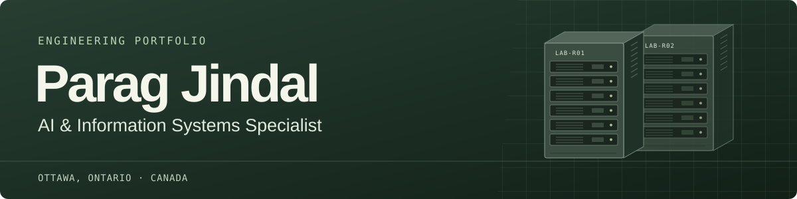
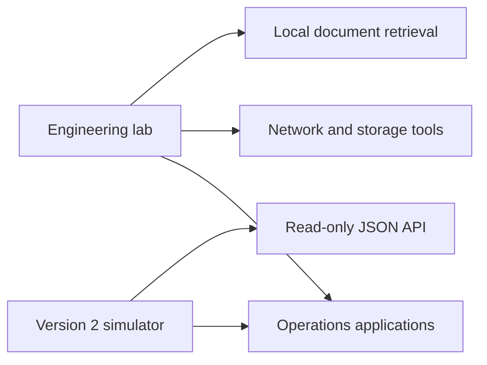

  
  
<a href="https://paragjindal.com/">Portfolio</a> · <a href="https://paragjindal.com/lab">Engineering Lab</a> · <a href="https://www.linkedin.com/in/parag-jindal-604b41320/">LinkedIn</a> · <a href="mailto:paragjindal023@gmail.com">Email</a>

## About me

I’m an **AI & Information Systems Specialist** based in Ottawa, Ontario, Canada, and a Bachelor of Computer Information Systems graduate from Okanagan College. I build AI applications and full-stack software and work with the GPU, networking, virtualization, and storage infrastructure that supports them.

## RelayOps AI

A visual studio for validating, running, and reviewing workflows. The public demo runs offline in the browser. The local SQLite service persists workflow versions, execution events, and approvals across restarts.

[Interactive demo](https://paragjindal.com/relayops/) · [Source and architecture](https://github.com/Paragjindal01/paragjindal-portfolio/tree/main/relayops-ai) · [Measured workflow runs](https://github.com/Paragjindal01/paragjindal-portfolio/blob/main/relayops-ai/docs/benchmark.md)

Try the GitHub review, sample-source research pipeline, CSV/JSON analysis, or synthetic incident investigator. The incident workflow pauses for an explicit approval before it records a simulated mitigation.

## Independent engineering lab

Explore eight interactive applications built in a personal monorepo. Operational projects share a deterministic fictional data centre with normal, warning, critical, and recovery scenarios.

| Application | What to try | Source and case study |
| --- | --- | --- |
| **InfraPilot AI** | [Query a critical incident and review an operator handoff](https://paragjindal.com/lab/infrapilot-ai?scenario=critical) | [Source](https://github.com/Paragjindal01/paragjindal-portfolio/blob/main/src/lab/apps/InfraPilot.jsx) · [Case study](https://github.com/Paragjindal01/paragjindal-portfolio/blob/main/docs/projects/infrapilot-ai.md) |
| **RackOps** | [Inspect an interactive 2D floor plan and 3D rack](https://paragjindal.com/lab/rackops) | [Source](https://github.com/Paragjindal01/paragjindal-portfolio/blob/main/src/lab/apps/RackOps.jsx) · [Case study](https://github.com/Paragjindal01/paragjindal-portfolio/blob/main/docs/projects/rackops.md) |
| **GPUWatch** | [Filter accelerator telemetry and adjust thresholds](https://paragjindal.com/lab/gpuwatch) | [Source](https://github.com/Paragjindal01/paragjindal-portfolio/blob/main/src/lab/apps/GPUWatch.jsx) · [Case study](https://github.com/Paragjindal01/paragjindal-portfolio/blob/main/docs/projects/gpuwatch.md) |
| **PowerOps** | [Balance PDU phases and confirm a simulated outlet action](https://paragjindal.com/lab/powerops) | [Source](https://github.com/Paragjindal01/paragjindal-portfolio/blob/main/src/lab/apps/PowerOps.jsx) · [Case study](https://github.com/Paragjindal01/paragjindal-portfolio/blob/main/docs/projects/powerops.md) |
| **FabricLab** | [Design an Ethernet or InfiniBand topology](https://paragjindal.com/lab/fabriclab) | [Source](https://github.com/Paragjindal01/paragjindal-portfolio/blob/main/src/lab/apps/FabricLab.jsx) · [Case study](https://github.com/Paragjindal01/paragjindal-portfolio/blob/main/docs/projects/fabriclab.md) |
| **VirtScan** | [Synchronize hosts, VMs, and containers and inspect changes](https://paragjindal.com/lab/virtscan) | [Source](https://github.com/Paragjindal01/paragjindal-portfolio/blob/main/src/lab/apps/VirtScan.jsx) · [Case study](https://github.com/Paragjindal01/paragjindal-portfolio/blob/main/docs/projects/virtscan.md) |
| **StorageCalc** | [Compare replicated and erasure-coded capacity](https://paragjindal.com/lab/storagecalc) | [Source](https://github.com/Paragjindal01/paragjindal-portfolio/blob/main/src/lab/apps/StorageCalc.jsx) · [Case study](https://github.com/Paragjindal01/paragjindal-portfolio/blob/main/docs/projects/storagecalc.md) |
| **LocalMind** | [Explore cited answers from a fictional document set](https://paragjindal.com/lab/localmind) | [Source](https://github.com/Paragjindal01/paragjindal-portfolio/blob/main/src/lab/apps/LocalMind.jsx) · [Case study](https://github.com/Paragjindal01/paragjindal-portfolio/blob/main/docs/projects/localmind.md) |

[InfraPilot incident replay](https://paragjindal.com/lab/infrapilot-ai#incident-replay) · [Simulator and CLI](./labs/infra-sim) · [Snapshot API](https://paragjindal.com/api/simulation?scenario=critical) · [Portfolio source](https://github.com/Paragjindal01/paragjindal-portfolio)

## Selected software projects

| Project | Focus |
| --- | --- |
| [SafeKelowna](https://safekelowna.com/) | Community safety map, reporting, messaging, and moderation |
| Algorithmic Trading Platform | Team capstone for market data processing and XGBoost prediction serving with FastAPI, PostgreSQL, Docker, and HPC tooling |
| Diagram Data Warehouse | Academic collaboration using React, GraphQL, and cloud storage for diagram upload, discovery, and analysis |
| [Financial Analytics iOS App](https://github.com/Paragjindal01/financial-analytic-ios-app) | Mobile application development |
| [Cybersecurity Home Lab](https://github.com/Paragjindal01/cybersecurity-home-lab) | Networking and security fundamentals |
| [Computer Networks](https://github.com/Paragjindal01/COSC-417-Computer-Network) | Networking coursework |

## Tools and infrastructure

GPU infrastructure · Proxmox · Ethernet and InfiniBand · VLAN design · Ceph capacity planning · Observability · Ollama · Retrieval-augmented generation · GitHub Actions

[GitHub contributions](https://github.com/Paragjindal01?tab=overview#contribution-graph) · [Public repositories](https://github.com/Paragjindal01?tab=repositories)
