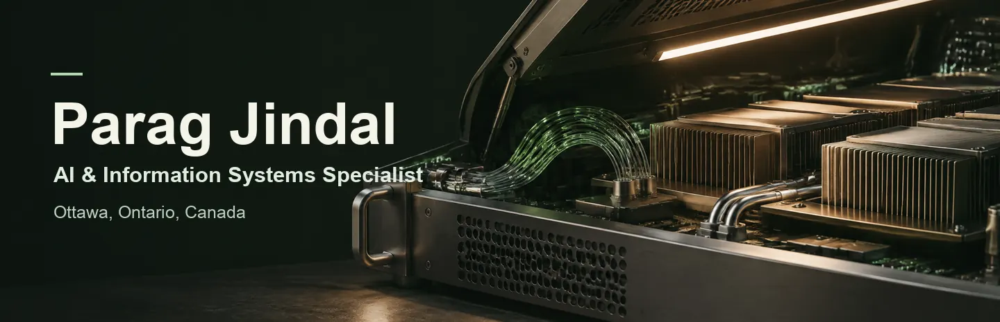
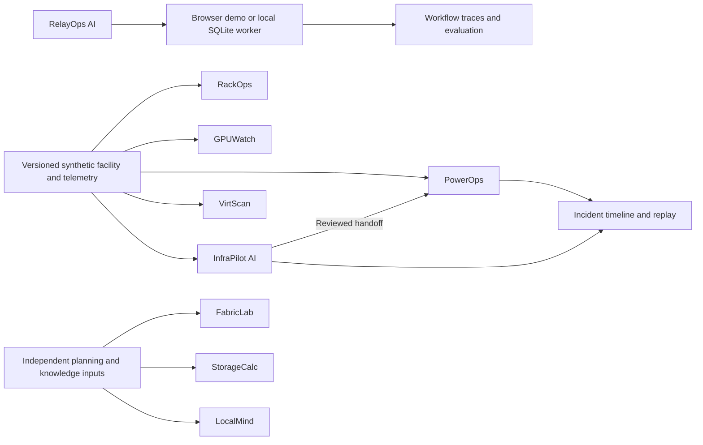

<!-- Generated from the portfolio professional data and project catalog. -->

# Parag Jindal

**AI & Information Systems Specialist**

AI Product Engineering · Intelligent Automation · Full-Stack Development · GPU Infrastructure

Building Intelligence. Engineering What Powers It.

Ottawa, Ontario, Canada

[Website](https://paragjindal.com/) · [Engineering lab](https://paragjindal.com/lab) · [LinkedIn](https://www.linkedin.com/in/parag-jindal-604b41320/) · [Email](mailto:paragjindal023@gmail.com)

## Flagship products

Independent software with runnable demos and published engineering evidence. The cover artwork is conceptual. Product screenshots show the actual applications.

### RelayOps AI

Versioned workflow graphs, durable SQLite execution, human approval, signed local webhooks, traces, and recorded evaluations.

 

[Demo](https://paragjindal.com/relayops/) · [Source](https://github.com/Paragjindal01/paragjindal-portfolio/tree/main/relayops-ai) · [Technical case study](https://paragjindal.com/case-studies/relayops-ai)

### InfraPilot AI

Validated operational queries and report exports with captured telemetry, recommendations, approval decisions, and linked PowerOps actions.

 

[Demo](https://paragjindal.com/lab/infrapilot-ai) · [Source](https://github.com/Paragjindal01/paragjindal-portfolio/blob/main/src/lab/apps/InfraPilot.jsx) · [Technical case study](https://paragjindal.com/case-studies/infrapilot-ai)

### RackOps

2D facility navigation, front and rear rack views, free rack units, and PDU-to-workload dependencies.

 

[Demo](https://paragjindal.com/lab/rackops) · [Source](https://github.com/Paragjindal01/paragjindal-portfolio/blob/main/src/lab/apps/RackOps.jsx) · [Technical case study](https://paragjindal.com/case-studies/rackops)

### GPUWatch

Per-GPU metrics, historical threshold exposure within a replay window, utilization charts, and report exports.

 

[Demo](https://paragjindal.com/lab/gpuwatch) · [Source](https://github.com/Paragjindal01/paragjindal-portfolio/blob/main/src/lab/apps/GPUWatch.jsx) · [Technical case study](https://paragjindal.com/case-studies/gpuwatch)

### PowerOps

PDU inventory, outlet mapping, modeled energy, phase balancing, and before/after audit exports.

 

[Demo](https://paragjindal.com/lab/powerops) · [Source](https://github.com/Paragjindal01/paragjindal-portfolio/blob/main/src/lab/apps/PowerOps.jsx) · [Technical case study](https://paragjindal.com/case-studies/powerops)

### LocalMind

Browser-local document retrieval, traceable citations, and side-by-side indexing evaluation.

 

[Demo](https://paragjindal.com/lab/localmind) · [Source](https://github.com/Paragjindal01/paragjindal-portfolio/blob/main/src/lab/apps/LocalMind.jsx) · [Technical case study](https://paragjindal.com/case-studies/localmind)

## Professional experience

### AltaAI Inc.

#### AI & Information Systems Specialist

September 2026 – Present · Permanent full-time · On-site · Ottawa, Ontario, Canada

Develop AI-assisted infrastructure operations and internal software. Contribute to GPU and high-performance computing deployment planning and validation.

- Build agent and API workflows to collect, normalize, and analyze infrastructure data. Develop internal integrations, operational reporting, and business process automation.
- Develop DCIM capabilities for asset hierarchy, interactive 2D and 3D rack inspection, equipment discovery, VM and container inventory, resource and environmental telemetry, and PDU monitoring. Design role-based access and audit logging for sensitive workflows.
- Plan GPU architecture, management and control servers, equipment integration, and validation. Evaluate management networks, VLANs, port mapping, and redundant Ethernet and InfiniBand designs.
- Plan shared Ceph storage with replication, capacity headroom, and failure domains. Use read-only Proxmox integrations, React and Next.js, Python and Node.js, REST and GraphQL, PostgreSQL, Docker, documentation, and automated testing.

#### AI Product Engineer

May 2026 – September 2026 · Permanent part-time · Remote

Developed internal AI products and productivity tools across retrieval, backend services, and business workflow automation.

- Developed self-hosted retrieval and semantic search workflows with FastAPI, Ollama, and ChromaDB. Worked on PostgreSQL migration and self-hosted database infrastructure.
- Built LinkedIn workflow integrations for scheduled comment monitoring, AI-assisted response drafts, and content generation. Used Node.js and OAuth2 for integration work.
- Implemented API authentication, input validation, and rate limiting. Troubleshot GPU, CUDA, and Docker environments for local AI development.

### Best Buy / Geek Squad

**Field Service Agent**

April 2026 – September 2026 · Permanent full-time · On-site · Kelowna, British Columbia, Canada

Diagnosed and resolved hardware, software, Wi-Fi, and peripheral issues in field service. Installed and configured devices and communicated fixes to customers.

### Okanagan College

**Student Employee — Peer Support and Athletics & Recreation**

January 2025 – April 2026 · On-site · Kelowna, British Columbia, Canada

Supported students, campus programs, recreation operations, and events through front-line service and team collaboration.

## Engineering laboratory

- **FabricLab** · Build an Ethernet or InfiniBand topology, assign ports and VLANs, and validate redundancy. [Demo](https://paragjindal.com/lab/fabriclab) · [Case study](https://paragjindal.com/case-studies/fabriclab)
- **VirtScan** · Synchronize hosts, VMs and containers, compare inventory snapshots, and export the results. [Demo](https://paragjindal.com/lab/virtscan) · [Case study](https://paragjindal.com/case-studies/virtscan)
- **StorageCalc** · Compare replication and erasure coding, model a node outage, and quantify expansion headroom. [Demo](https://paragjindal.com/lab/storagecalc) · [Case study](https://paragjindal.com/case-studies/storagecalc)

[Standalone source and installation](https://github.com/Paragjindal01/paragjindal-portfolio/tree/main/packages/standalone) · [Simulation API](https://paragjindal.com/api/simulation?scenario=critical) · [InfraPilot incident replay](https://paragjindal.com/lab/infrapilot-ai#incident-replay)

## Selected software

- **[SafeKelowna](https://safekelowna.com/)** · Community safety map, reporting, messaging, and moderation.
- **Algorithmic Trading Platform** · Team capstone for market data processing and XGBoost prediction serving.
- **Diagram Data Warehouse** · Academic collaboration for diagram upload, search, and analysis.

Earlier work includes the [Financial Analytics iOS App](https://github.com/Paragjindal01/financial-analytic-ios-app), [Cybersecurity Home Lab](https://github.com/Paragjindal01/cybersecurity-home-lab), and [Computer Networks coursework](https://github.com/Paragjindal01/COSC-417-Computer-Network).

## Technology

- **AI and Machine Learning** · Ollama, Retrieval-augmented generation, ChromaDB, XGBoost
- **Agentic AI and Automation** · Structured tool calling, Workflow orchestration, Evaluation, Approval gates
- **Backend Engineering** · Python, FastAPI, Node.js, REST, GraphQL
- **Frontend Engineering** · React, Next.js, TypeScript, Vite
- **Data and Storage** · PostgreSQL, SQLite, Ceph, Distributed storage
- **GPU Infrastructure** · CUDA, NVML, Slurm, GPU deployment planning
- **Networking and Virtualization** · Proxmox, Ethernet, InfiniBand, VLANs
- **DevOps and Security** · Linux, Docker, GitHub Actions, Vercel, OAuth2, Audit logging

## Education

**Bachelor of Computer Information Systems** · Okanagan College

Software Development specialization · Completed April 2026

## Releases and verification

 

[Engineering releases](https://github.com/Paragjindal01/paragjindal-portfolio/releases) · [RelayOps measured runs](https://github.com/Paragjindal01/paragjindal-portfolio/blob/main/relayops-ai/docs/benchmark.md) · [Actual GitHub contributions](https://github.com/Paragjindal01?tab=overview#contribution-graph)

The public infrastructure demos use fictional data and simulated controls. The work history describes business responsibilities at a public, technical level.
