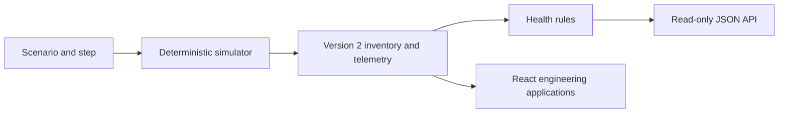

# Infrastructure simulator

A dependency-free engine for exploring a fictional data centre. Version 2 adds a facility and rooms, four racks, 16 servers, switches, metered PDU outlets, virtual machines, containers, and four repeatable operating scenarios.

## Run locally

Use Node.js 22 or later from this directory.

```sh
node cli-v2.mjs critical 0
node cli-v2.mjs recovery 12
node --test
```

`simulator-v2.mjs` exports `createSnapshot({ scenario, step })`, `history(scenario, steps)`, and `analyze(snapshot)`. The fields carry explicit units. Each step advances 15 synthetic minutes. The same input always yields the same snapshot. The original `cli.mjs` and `simulator.mjs` continue to expose the version 1 contract.

| Scenario | What to look for |
| --- | --- |
| Normal | Nominal temperatures and varying workload demand |
| Warning | Warmer intake, higher humidity, and increased accelerator load |
| Critical | GPU thermal alerts, an offline storage node, and high power demand |
| Recovery | Lower thermal and power readings after the incident |



The browser version and HTTP contract live in the [engineering lab source](https://github.com/Paragjindal01/paragjindal-portfolio/tree/main/src/lab). [Open the engineering lab](https://paragjindal.com/lab).

All data is synthetic, including reserved documentation IP addresses and locally administered MAC addresses. Alert thresholds illustrate the scenarios. The simulator makes no network or hardware calls. The browser power exercises use a separate in-memory control adapter.
