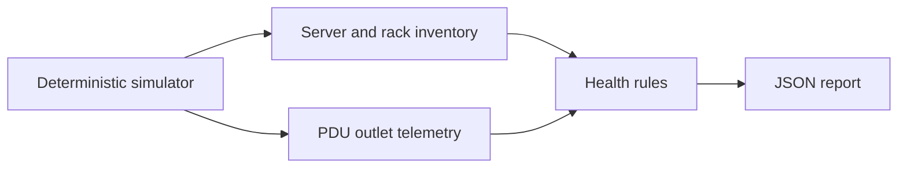

# Infrastructure Lab — v0.1

An independent, dependency-free synthetic infrastructure simulator for developing observability, inventory, PDU monitoring and automation prototypes. All names, topology and telemetry are fictional. No employer or customer data, code or equipment connections are used.

## Run locally

Requires Node.js 20 or later. From this directory:

```sh
node cli.mjs 0
node cli.mjs 4
node --test simulator.test.mjs
````

Step 4 introduces a simulated GPU temperature warning. Every fifth step repeats this scenario. The CLI emits JSON containing an inventory snapshot and a rule-based health report. The engine is deterministic and can be used by other applications through its exported functions.

## Architecture



## Data and safeguards

- Three fictional racks, six servers, three PDUs and linked outlet readings.
- Synthetic CPU, GPU, memory, temperature and power metrics.
- Aggregate power reconciles with individual server loads.
- Illustrative warning thresholds: 80 C GPU temperature and 80% PDU utilization. Not equipment operating specifications.
- Read-only rule-based analysis; no LLM, real API, live power switching or remote actions in this version.
- No runtime dependencies, external services or secrets.

## Next steps

Add a browser dashboard, schema validation, recorded scenario fixtures and an optional read-only AI tool layer. Future PDU control demonstrations must remain simulated and include authorization, confirmation and an audit trail.

Development status: working simulator prototype. Not a production DCIM or monitoring system. License for future standalone repository to be decided by the owner.
